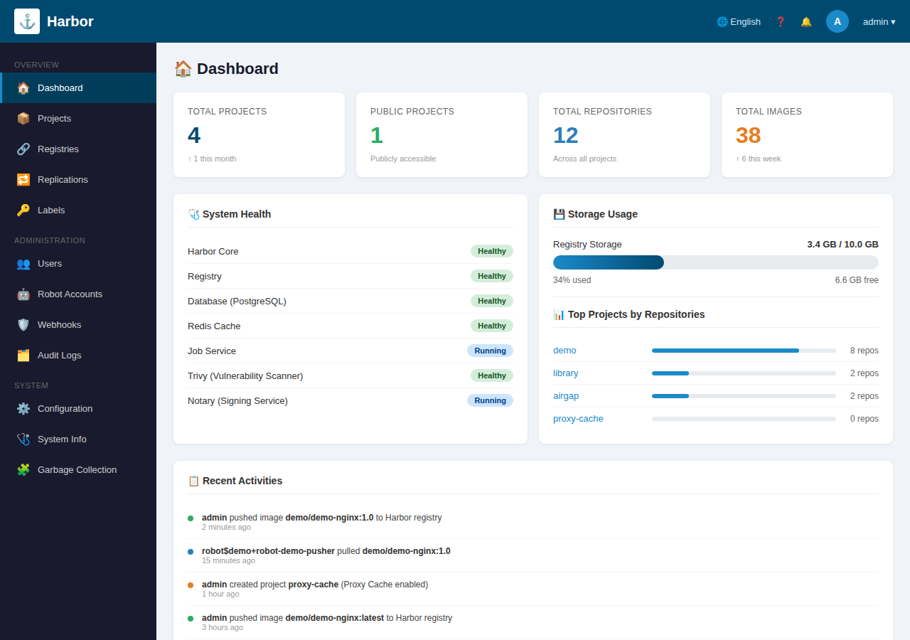
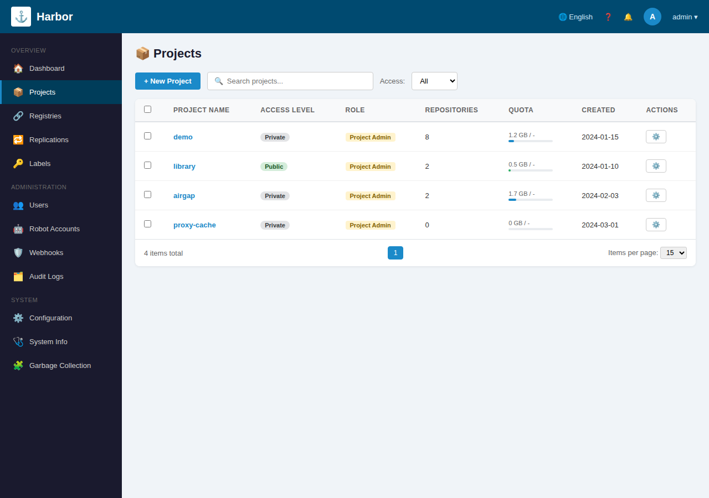
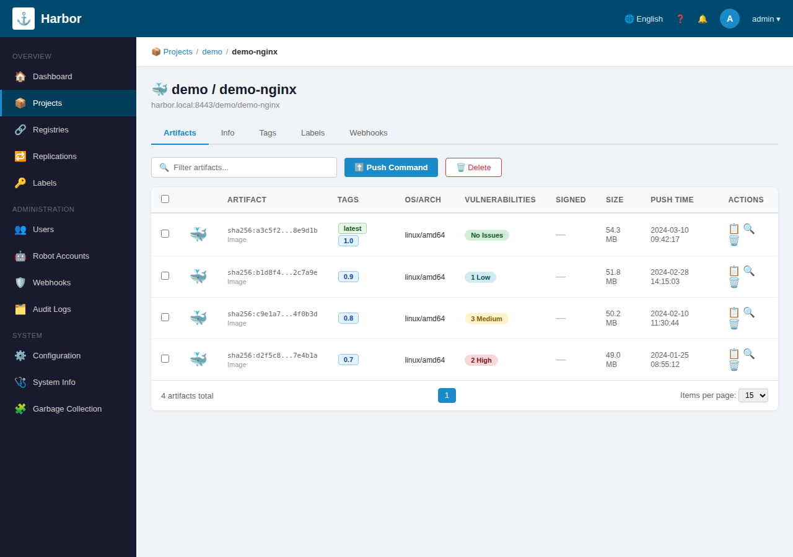

# Harbor WSL2 Lab (Windows + WSL2 + Docker Desktop)

**English** | [한국어](README-KR.md)

This repository is a hands-on lab for learning to run **Harbor the way you would operate it in an air-gapped network**. Each chapter (01–) includes:

- A detailed guide (README)
- A runnable `.sh` script
- (Optional) Windows PowerShell helper scripts

> Recommended environment: **Windows 10/11 + WSL2 (Ubuntu) + Docker Desktop (WSL integration ON)**

## Quick start

```bash
cp .env.example .env
chmod +x -R chapters/**/run.sh scripts/*.sh
./chapters/01_check_env/run.sh
```

## Optional tools

### kind (pin a stable version)

Pin a known version instead of tracking the latest release.

```bash
KIND_VER="v0.22.0"

curl -Lo /usr/local/bin/kind "https://kind.sigs.k8s.io/dl/${KIND_VER}/kind-linux-amd64"
chmod +x /usr/local/bin/kind
kind version
```

### kubectl

```bash
sudo apt-get update
sudo apt-get install -y kubectl
kubectl version --client --output=yaml | head
```

## Chapters

- Chapter 01: Environment check (Docker Desktop + WSL2)
- Chapter 02: Install and start Harbor (HTTPS, self-signed)
- Chapter 03: Register hosts and the CA trust chain (so Docker trusts TLS)
- Chapter 04: Create a project and a robot account (concepts and lab)
- Chapter 05: Build a sample nginx image, push/pull it through Harbor, and run it
- Chapter 06: Air-gap simulation (save/load/tar import flow)
- Chapter 07: Image retention and tagging habits
- Chapter 08: (Optional) Pull a Harbor image from a local kind cluster
- Chapter 09: Backup and restore (concepts) plus data directory management
- Chapter 10: Teardown (down/cleanup)
- Chapter 11: Harbor proxy cache (external registry cache/mirror)
- Chapter 12: vLLM inference server image skeleton (base for large-model operations)
- Chapter 13: Kubernetes deploy templates (vLLM + imagePullSecret + probes + NodePort)
- Chapter 14: Generate a Fractos RCS UI parameter sheet (no WSL or Kubernetes required)
- Chapter 15: Fractos RCS UI deploy runbook (model/NFS/TP=3/NodePort/health checks)
- Chapter 16: Air-gap operations preflight (import → Harbor → checks before a Fractos deploy)
- Chapter 17: Create and delete a kind cluster quickly (WSL2 + Docker)
- Chapter 18: Pull and deploy a Harbor (HTTPS) image from kind (Secret and CA included)

## Harbor web UI screenshots

### 1. Dashboard

The main screen for project count, image count, system status, storage usage, and recent activity.



### 2. Projects

Lists projects and manages access (public/private), repository count, and quota.



### 3. Repository artifacts

Shows tags, digests, vulnerability scan results, and size for images pushed to a repository.



## Key concepts

- **Harbor is an internal registry.** In an air-gapped network, point clients at Harbor instead of Docker Hub.
- **Docker does not require the public internet to run.** Internet access is only needed to pull external images or download packages. Once images live in Harbor, you can operate without it.
- **HTTPS (self-signed or an internal CA) is the production default.** The critical step is registering the trust chain so Docker and node runtimes trust that CA.

## Default ports and domain

- HTTPS UI/registry: `https://harbor.local:8443`
- HTTP (optional): `http://harbor.local:8080`
- Change these in `.env`

## Cautions

- Chapter 03 “install the CA on Windows” may require administrator rights, so automation is intentionally limited.
- Organization policy may restrict changes to the local certificate store.

## Additional scenario

- CH18-robot: Pull and deploy a Harbor image from kind using a pull-only robot account
